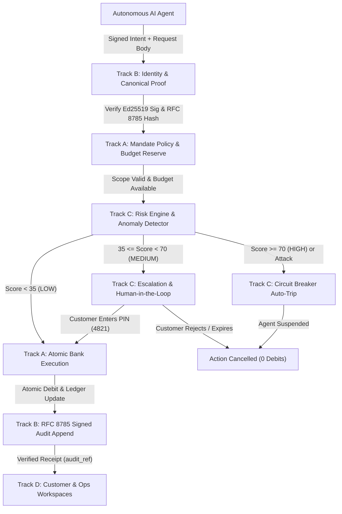

# AgentGate: Autonomous Agent Governance & Financial Safety Gateway

> **Defense-in-depth gateway for governing, risk-scoring, and executing financial transactions requested by autonomous AI agents.**

[](https://www.python.org/)
[](https://fastapi.tiangolo.com/)
[](https://react.dev/)
[](https://www.typescriptlang.org/)
[](https://vitejs.dev/)
[](LICENSE)
[](contracts/)

---

## 1. Executive Summary & Problem Statement

Autonomous AI agents (LLMs) are increasingly tasked with real-world financial activities: paying recurring utility bills, procuring cloud compute, and booking travel. However, granting agents raw API keys or standard banking access introduces severe security vulnerabilities:
- **Prompt Injection & Payee Redirection:** Attackers poison agent context to reroute funds to unverified accounts.
- **Velocity Bursts & Structuring:** Rogue or compromised agents split unauthorized payments just beneath human review thresholds.
- **Budget Exhaustion & Concurrency Races:** Multiple parallel subagents requesting simultaneous debits that exceed customer budget ceilings.
- **Lack of Non-Repudiable Evidence:** Traditional audit logs are mutable and lack cryptographic proof linking customer intent to agent actions.

**AgentGate** solves this by inserting a hardened, four-track governance gateway between autonomous agents, banking rails, and human account holders.

---

## 2. Core Architecture & Governance Pipeline

AgentGate enforces a zero-trust execution pipeline where every agent transaction must satisfy four independent verification boundaries:



---

## 3. Four-Track Modular Architecture

The repository is organized into four strictly decoupled tracks:

| Track | Owner Area | Responsibilities & Capabilities |
| :--- | :--- | :--- |
| **Track A — Enforcement & Integration** | `gateway/platform`<br>`gateway/mandates`<br>`gateway/executor`<br>`bank_mock/` | • SQLite WAL engine with strict serializable foreign keys.<br>• Signed mandate lifecycle & cross-customer tenant isolation.<br>• Atomic budget reservation & debit invariance.<br>• Bank mock with idempotency conflict checks and balance tracking. |
| **Track B — Identity & Audit** | `gateway/identity`<br>`gateway/audit`<br>`agent_sdk/` | • RFC 8785 canonical JSON serialization & Ed25519 signature checks.<br>• Public-key agent identity registry.<br>• Append-only hash-linked cryptographic audit chain.<br>• Non-repudiable JSON regulatory evidence bundles. |
| **Track C — Risk & Approval** | `gateway/risk`<br>`gateway/escalation`<br>`simulator/` | • Explainable Noisy-OR probabilistic risk engine (8 independent signals).<br>• Calibrated bands: `LOW` (Allow), `MEDIUM` (Escalate), `HIGH` (Deny).<br>• Tri-trigger circuit breaker with scope-based auto-suspension.<br>• Persistent escalation storage, TTL expiry, and PIN authorization.<br>• Full deterministic test harness (`S1`–`S11`). |
| **Track D — Customer / Ops Experience** | `frontend/`<br>`docs/DEMO.md` | • React 19 + TypeScript + Vite web portal.<br>• Customer Portal: Mandates, real-time budget tracking, approval inbox.<br>• Operations Console: Agent registry, audit verifier with tamper simulation.<br>• Dual-transport mode: Stateful Mock Fixtures & Live FastAPI Gateway. |

---

## 4. Deterministic Scenario Suite (S1 – S11)

AgentGate includes 18 end-to-end scenarios covering all attack vectors and normal lifecycles:

| Scenario | Objective | Enforced Boundary | Expected Outcome |
| :--- | :--- | :--- | :--- |
| **S1** | Happy Path Bill Payment | Valid mandate, trusted payee, low risk. | Balance debited exactly once (12.5M paise $\to$ 12.315M paise). Audit Ref emitted. |
| **S2a** | Per-Transaction Cap | Single payment exceeds per-transaction limit. | Denied (`E_POLICY_PER_TXN_EXCEEDED`). Zero money moves. |
| **S2b** | Unlisted Payee | Payment to unapproved biller ID. | Denied (`E_POLICY_PAYEE_UNLISTED`). Balance unchanged. |
| **S2c** | Unauthorized Transfer | Action type not permitted by delegation scope. | Denied (`E_POLICY_ACTION_FORBIDDEN`). Usage unchanged. |
| **S2d** | Policy Probing Attack | 5 hard policy denials within 10 minutes. | Circuit breaker trips. Agent automatically suspended. |
| **S3** | Concurrency Race | 5 concurrent requests race for 2 budget slots (100 runs). | Invariance preserved: exactly 2 execute, 3 fail on budget. 0 overspends. |
| **S4** | Mandate Expiry | Action at +30s vs boundary at +91s (90s mandate). | Success at +30s; hard rejection at +91s (`E_MANDATE_EXPIRED`). |
| **S5** | Mandate Revocation | Revoke active delegation mid-flight. | Pending approvals cancelled; subsequent attempts fail immediately. |
| **S6** | Identity & Replay | Stolen tokens, replay attacks, altered payloads. | Cryptographic rejection; RFC 8785 byte verification prevents payload tampering. |
| **S7** | Prompt Injection | Poisoned invoice directing ₹40,000 to `PAYEE-X`. | Hard DENY; intent-mismatch + unverified payee triggers instant breaker trip. |
| **S8** | Structuring Attack | Rapid succession of ₹1,990 transactions. | Att. 1: LOW; Att. 2–3: Escalated; Att. 4: Tripped & Denied. Max 1 executes. |
| **S9a** | Human Approval | ₹4,800 medium-risk quarterly utility surge. | Stays PENDING; customer enters PIN `4821`; executed once with receipt. |
| **S9b-c**| Reject & Expiry | Customer rejects or clock advances past TTL. | Escalation marked REJECTED/EXPIRED; zero bank calls made. |
| **S9d** | Approval Reuse | Replaying an approved decision token. | Rejected; idempotent execution prevents duplicate debits. |
| **S9e** | Wrong PIN & Spam | 4th pending request or incorrect PIN. | Wrong PIN rejected and audited; 4th creation rejected by pending cap. |
| **S10** | Audit Tamper Detection | Modified historical ledger entry. | Cryptographic chain verification detects exact corrupt block. |
| **S11** | Regulatory Evidence | Complete post-mortem audit extraction. | Self-contained JSON evidence bundle with historical mandate & signatures. |

---

## 5. Measured Quantitative Benchmarks

Historical synthetic measurements from `tools/metrics.py` follow. S3 uses a fixture ledger, latency measures the risk scorer, and throughput measures an in-memory SHA-256 chain. The Windows runbook records the live payment independently.

```
====================================================================================
                      AGENTGATE QUANTITATIVE METRICS REPORT                         
====================================================================================
Git Commit:       3a18e749
Scoring Model:    1.0.0-noisy_or | Profile: scripted (balanced 35/70)
------------------------------------------------------------------------------------
[1] CONCURRENCY BUDGET INVARIANCE (S3 Race Test)
    • Iterations:                     100 parallel runs (5 requests each)
    • Observed Overspends:            0 / 100  [Target: 0 -> ACHIEVED]

[2] MEASURED DECISION PIPELINE LATENCY
    • Sample Trials:                  300 calls
    • Median Latency (p50):           0.017 ms
    • 95th Percentile Latency (p95):  0.060 ms  [Target: < 100.0 ms -> ACHIEVED]
    • Max Latency:                    0.206 ms

[3] ATTACK DETECTION & FALSE POSITIVES
    • Attack Traces Evaluated:        20 / 20 Detected (100.0% True Positive)
    • Normal Traces Evaluated:        25 / 25 Clean (0.0% False Positive)
    • Empirical Precision:            100.0%

[4] CRYPTOGRAPHIC AUDIT VERIFICATION THROUGHPUT
    • Audit Blocks Checked:           1,000 entries
    • Verification Duration:          2.33 ms  [Target: < 1,000.0 ms -> ACHIEVED]
====================================================================================
```

---

## 6. Installation & Prerequisites

### Prerequisites
- **Python:** 3.12 (`uv` package manager recommended)
- **Node.js:** v24.x & **npm:** v11.x
- **Git**

### Installation

```bash
# Clone the repository
git clone https://github.com/syedsaqif/AgentGate.git
cd AgentGate

# Setup Python virtual environment & dependencies
uv sync --frozen

# Setup Frontend dependencies
cd frontend
npm ci
cd ..
```

---

## 7. Running the System

Start the disposable real gateway and simulated bank in one PowerShell terminal after installation.

```powershell
powershell -NoProfile -File .\tools\demo.ps1
```

Start Vite in a second terminal from the checkout root.

```powershell
Set-Location frontend
$env:VITE_GATEWAY_ORIGIN = 'http://127.0.0.1:8000'
npm run dev:real -- --strictPort
```

Open `http://127.0.0.1:5173/customer` and `http://127.0.0.1:5173/ops`. Use the credentials chosen at launch. The complete signed payment example and automated clean-start commands are in the [Windows runbook](docs/d/README.md).

## 8. Verification & Test Commands

Run the following checks from the checkout root.

```powershell
# 1. Verify frozen contract specifications across all owners
uv run python -m tools.dev check-contracts

# 2. Run the complete Python test suite (unit, contract, adapters)
uv run pytest -v

# 3. Execute strict linter checks
uv run ruff check

# 4. Run the configured strict contract gate, then the wider diagnostic
uv run mypy
uv run mypy contracts gateway simulator tools tests/c tests/a

# 5. Run all 18 deterministic simulator scenarios (S1-S11)
uv run python -m simulator.runner --all --profile scripted

# 6. Generate the quantitative performance & latency metrics
uv run python -m tools.metrics

# 7. Frontend typecheck, unit tests, and production build
cd frontend
npm run typecheck
npm test -- --run
npm run build
```

---

## 9. 7-Minute Live Demonstration Walkthrough

Use the [presenter script](docs/DEMO.md) and [milestone evidence](docs/TEST_RUN.md). The Customer creates and approves the mandate-bound payment. Ops uses its request ID to verify and download the evidence.

## 10. Repository File Structure

```text
AgentGate/
├── agent_sdk/             # Track B: Client SDK for AI agents
├── bank_mock/             # Track A: Core banking engine double
├── contracts/             # Frozen shared contracts (v1.0.0)
│   ├── canonical.py       # RFC 8785 canonical JSON & hash calculation
│   ├── core_models.py     # Mandates, Actions, Grants, Audit schemas
│   ├── openapi.json       # 27 OpenAPI route definitions
│   └── fixtures/          # Shared test fixtures for tracks A, B, C, D
├── docs/                  # Architectural documentation & demo scripts
│   ├── DEMO.md            # Rehearsal & live presentation walkthrough
│   └── c/README.md        # Risk scoring weights & Noisy-OR formula
├── frontend/              # Track D: React 19 + TypeScript web application
│   ├── src/
│   │   ├── api/           # API transport & client abstractions
│   │   ├── mocks/         # Stateful mock fixtures for offline demo
│   │   ├── pages/         # Customer and Operations workspaces
│   │   └── styles.css     # Modern dashboard styling
│   └── tests/             # Vitest component test suite
├── gateway/               # FastAPI Gateway implementation
│   ├── platform/          # SQLite WAL database & UoW transaction coordinator
│   ├── mandates/          # Mandate persistence & isolation routes
│   ├── risk/              # Noisy-OR risk engine & circuit breaker
│   └── escalation/        # Human approval lifecycle & PIN verification
├── simulator/             # Track C: Deterministic scenario harness (S1-S11)
├── tests/                 # Unit, contract, and adapter test suites
└── tools/                 # Developer CLI & quantitative metrics engine
```

---

## 11. Security Posture & Non-Negotiable Invariants

- **Zero Overspend Guarantee:** Transactions are committed atomically against SQLite WAL using `PRAGMA busy_timeout=5000` and serializable transaction barriers.
- **PIN Isolation:** Customer PINs are hashed with Argon2id and never appear in ordinary logs, audit payloads, or client-side storage.
- **In-Memory Session Security:** Human session tokens are stored exclusively in memory and never written to `localStorage` or URL query parameters.
- **Deterministic Cryptographic Verification:** All action hashes and audit chain links use strict RFC 8785 canonical JSON sorting before hashing with SHA-256.

---

*(AgentGate is developed as a hackathon showcase demonstrating verifiable security and policy enforcement for autonomous financial agents).*
